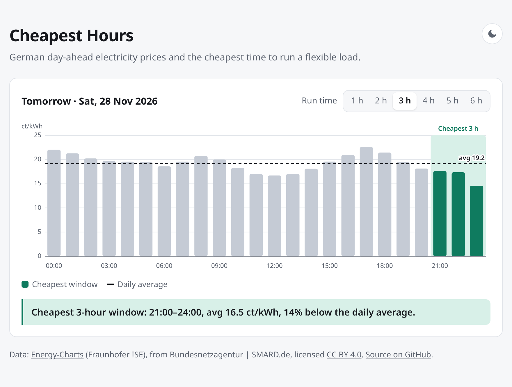
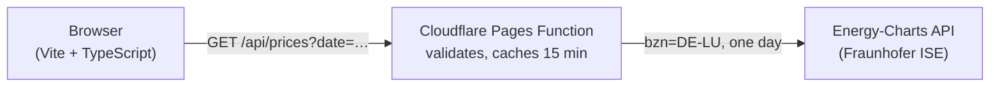

# Cheapest Hours

[](https://github.com/o-kangal/cheapest-hours/actions/workflows/ci.yml)
[](LICENSE)

**Live:** <https://cheapest-hours.pages.dev>

Shows Germany's day-ahead electricity prices for tomorrow (or today, until tomorrow's are published) as an hourly chart in ct/kWh.
Pick how long a flexible load runs, such as a heat pump buffer, EV charging or a batch process, and it highlights the cheapest uninterrupted window.



## Features

- Hourly day-ahead prices for the German–Luxembourg bidding zone (`DE-LU`), in ct/kWh, negative prices included.
- Run time selector from 1 to 6 hours; the cheapest contiguous window is highlighted in the chart and summarised in one line, e.g. _"Cheapest 3-hour window: 21:00–24:00, avg 16.5 ct/kWh, 14% below the daily average."_
- Tomorrow's prices as soon as they are published, today's until then, with a note saying which day is shown.
- Clear loading, error (with retry) and empty states.
- Works on phones, with the keyboard and with screen readers (text alternative for the chart, per-bar titles).
- Light and dark theme: follows the system setting, and a switch in the corner overrides it for this browser.
- No runtime dependencies: about 6 kB of JavaScript and CSS, gzipped.

## How it works



1. The page works out tomorrow's date in Berlin time and asks `/api/prices` for it; when that day has no prices yet, it asks for today.
2. The Pages Function accepts only a `date` (yesterday to the day after tomorrow), queries Energy-Charts for `DE-LU`, validates the response and caches it at the edge.
3. In the browser, the 15-minute prices are averaged into hours, and a pure function finds the run of N consecutive hours with the lowest mean price.

The domain logic in [`src/lib/`](src/lib) has no DOM, network or clock access, so it is fully unit-tested: windows never span gaps in the data, ties go to the earliest window, and DST days with 23 or 25 hours are covered.

## Decisions

| Decision | Why |
|---|---|
| **15-minute prices are averaged to hours** | Since October 2025 the day-ahead market (and Energy-Charts) uses 15-minute periods. The brief asks for hourly prices, and hours keep the chart readable. |
| **A Pages Function proxies the API** | Energy-Charts does not allow cross-origin requests from browsers. |
| **Responses are cached for 15 minutes** | The API rate-limits after a few quick requests. With the edge cache, each Cloudflare location asks upstream at most once per day and quarter of an hour. |
| **The proxy is closed** | It takes only a validated date in a four-day range and fixes the bidding zone, so it cannot be used as an open proxy or to drain the rate limit. |
| **Plain SVG instead of a chart library** | One bar chart with a highlight does not need a dependency; the SVG is sized in CSS pixels, so labels stay legible on phones. |
| **Berlin time everywhere** | Day boundaries and labels follow `Europe/Berlin`, whatever the viewer's time zone. A window ending at midnight reads `24:00`. |
| **Percentages only where they make sense** | When the daily average is zero or negative, or the window itself is negative, the summary states the difference in ct/kWh instead of a percentage. |

## Development

Requires Node.js 24+ and pnpm (the version in `packageManager`; `corepack enable` picks it up).

```bash
pnpm install --frozen-lockfile
pnpm dev            # front end only, at http://localhost:5173 (no /api)
pnpm run dev:full   # production build with the Pages Function, at http://localhost:8788
pnpm run typecheck  # app and Functions
pnpm run lint       # ESLint, then a Prettier check
pnpm run test       # Vitest
pnpm run build
```

CI runs these checks, a secret scan and CodeQL on every pull request and push to `main`, then deploys `main` to Cloudflare Pages ([`docs/deploy.md`](docs/deploy.md)).

## How it was built

Built with [Claude Code](https://claude.com/claude-code) in small, verified steps: [`SPEC.md`](SPEC.md) holds the behaviour and its rules, [`AGENTS.md`](AGENTS.md) the engineering constraints, and [`TASKS.md`](TASKS.md) the plan. Each task ended with its checks passing and a reviewed commit.

## Data and license

Price data: [Energy-Charts](https://www.energy-charts.info/) by Fraunhofer ISE, from Bundesnetzagentur | SMARD.de, licensed [CC BY 4.0](https://creativecommons.org/licenses/by/4.0/).

Code: [MIT](LICENSE).
